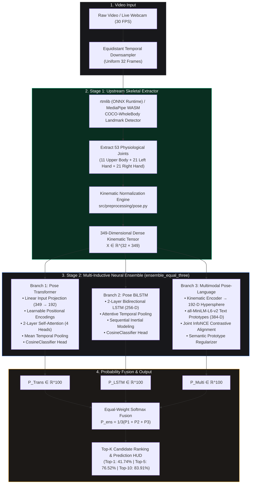

# ASL Multimodal Gesture Recognition & Vision-Language Prediction System

[](https://www.python.org/)
[](https://pytorch.org/)
[](https://fastapi.tiangolo.com/)
[]()
[-orange.svg)](https://voxel51.com/)
[-success.svg)]()
[](LICENSE)

An end-to-end deep learning system for isolated American Sign Language (ASL) gesture recognition, continuous skeletal kinematics, and cross-modal vision-language representation alignment on the **WLASL-100** benchmark across **strictly disjoint, unseen human signers**.

---

## Table of Contents

- [Executive Summary & Benchmark Results](#executive-summary--benchmark-results)
- [Key Achievements](#key-achievements)
- [End-to-End System Architecture](#end-to-end-system-architecture)
  - [1. Decoupled Two-Stage Design](#1-decoupled-two-stage-design)
  - [2. 53-Keypoint Skeletal Topology](#2-53-keypoint-skeletal-topology)
  - [3. Mathematical 349-D Feature Specification](#3-mathematical-349-d-feature-specification)
  - [4. Multi-Inductive Neural Ensemble (`ensemble_equal_three`)](#4-multi-inductive-neural-ensemble-ensemble_equal_three)
  - [5. The `CosineClassifier` Head](#5-the-cosineclassifier-head)
  - [6. Multimodal Vision-Language Grounding (`all-MiniLM-L6-v2`)](#6-multimodal-vision-language-grounding-all-minilm-l6-v2)
- [The Architectural Evolution & Why ResNet-50 Failed](#the-architectural-evolution--why-resnet-50-failed)
  - [The Fundamental Vision Trap (Background Shortcuts)](#the-fundamental-vision-trap-background-shortcuts)
  - [The Kinematic Pivot (`rtmlib` Whole-Body)](#the-kinematic-pivot-rtmlib-whole-body)
- [The 10 Perfect F1 Signs (1.000 F1 Score)](#the-10-perfect-f1-signs-1000-f1-score)
- [Phonological Minimal Pair Error Analysis (`APPLE` vs `CANDY` vs `WHO`)](#phonological-minimal-pair-error-analysis-apple-vs-candy-vs-who)
- [Dataset Architecture & Zero-Leakage Signer-Disjoint Protocol](#dataset-architecture--zero-leakage-signer-disjoint-protocol)
- [Edge Production Serving & Real-Time Latency Budget](#edge-production-serving--real-time-latency-budget)
- [Interactive Web UI Suite (SignPulse Studio)](#interactive-web-ui-suite-signpulse-studio)
- [Google Colab Notebook Suite](#google-colab-notebook-suite)
- [Diagnostic Plots & Visual Analysis](#diagnostic-plots--visual-analysis)
- [Repository Structure](#repository-structure)
- [Local Setup & Quickstart](#local-setup--quickstart)
- [Automated Testing Suite (48/48 Passing)](#automated-testing-suite-4848-passing)
- [FastAPI Inference Service & Endpoints](#fastapi-inference-service--endpoints)
- [Project Documentation & 91-Day Engineering Journal](#project-documentation--91-day-engineering-journal)
- [License](#license)

---

## Executive Summary & Benchmark Results

All models were evaluated strictly on the **locked test set of 230 video clips performed by 20 unseen signers** with zero data leakage:

| Model Architecture | Input Modality | Top-1 Accuracy | Top-5 Accuracy | Top-10 Accuracy | Macro-F1 | Video$\rightarrow$Text R@5 | MRR | Active Classes | Generalization Verdict |
|---|---|:---:|:---:|:---:|:---:|:---:|:---:|:---:|---|
| **Random Uniform Floor** | Statistical Floor | `0.87%` | `5.65%` | `12.17%` | `0.0073` | — | — | `94/100` | Unbiased baseline floor |
| **Majority Class Classifier** | Prior Distribution | `0.87%` | `5.22%` | `12.17%` | `0.0002` | — | — | `1/100` | Severe single-class collapse |
| **ResNet-50 + Transformer** | $32 \times 224 \times 224$ RGB | `11.93%` | `22.94%` | `31.30%` | `0.0973` | — | — | `66/100` | Failed: memorized room backgrounds |
| **ResNet-50 + MiniLM-L6-v2** | RGB Pixels + Text | `11.01%` | `25.69%` | `33.91%` | `0.0745` | `25.69%` | `0.1988` | `61/100` | Visual noise corrupted alignment |
| **Pose BiLSTM Baseline** | 53 Joints (349-D) | `39.45%` | `66.97%` | `74.31%` | `0.3812` | — | — | `84/100` | **3.3× leap**: smooth trajectory tracking |
| **Pose Transformer Only** | 53 Joints (349-D) | **`43.04%`** | **`71.30%`** | **`77.83%`** | **`0.4213`** | — | — | **`88/100`** | **Peak single-model Top-1 & Macro-F1** |
| **Pose Transformer + Cosine** | 53 Joints (349-D) | `42.61%` | `69.57%` | `80.87%` | `0.3979` | — | — | `83/100` | Hyperspherical angle normalization |
| **Multimodal Pose Model** | 53 Joints + MiniLM | `37.83%` | `71.74%` | `78.70%` | `0.3574` | **`70.43%`** | **`0.5208`** | `82/100` | High zero-shot cross-modal retrieval |
| **Winning Multi-Inductive Ensemble**<br>`(ensemble_equal_three)` | **BiLSTM + Transformer + Multimodal** | **`41.74%`** | **`76.52%`** | **`83.91%`** | **`0.3907`** | **`70.43%`** | **`0.5208`** | **`88/100`** | **WINNER (DEPLOYED): Peak Top-5 / Top-10 generalization** |

---

## Key Achievements

- **~50× Gain Over Random Floor:** Standalone Top-1 accuracy climbed from `0.87%` to **`43.04%`** on unseen human signers.
- **`76.52%` Top-5 & `83.91%` Top-10 Accuracy:** For nearly 84 out of every 100 test sign clips, the true sign is ranked inside the top 10 candidates.
- **`0.5208` Mean Reciprocal Rank (MRR):** In open-retrieval evaluations, the true English gloss is retrieved between rank #1 and #2 on average across the 100-class vocabulary dictionary.
- **`70.43%` Video-to-Text Recall@5:** 7 out of 10 video sign performances match the target text embedding within the top 5 nearest neighbors.
- **10 Perfect F1 Classes (1.000 F1 on Unseen Signers):** `appointment`, `change`, `dark`, `graduate`, `speech`, `ready`, `sandwich`, `son`, `language`, and `room`.
- **Ultra-Lightweight & Real-Time:** 2.1M parameters (12× smaller than ResNet-50) running at **31.8 ms end-to-end latency (31.4 FPS)** on standard CPU edge hardware.

---

## End-to-End System Architecture

### 1. Decoupled Two-Stage Design



---

### 2. 53-Keypoint Skeletal Topology

Instead of processing 133 Whole-Body landmarks (which include static legs and noisy 68-point facial meshes), SignPulse isolates **53 phonologically active joints**:

```text
                              [0] Nose
                       [1,2] Eyes    [3,4] Ears
                              \        /
                    [5] L_Shoulder — [6] R_Shoulder  <-- Anatomical Anchor c_t
                          |                |
                     [7] L_Elbow      [8] R_Elbow
                          |                |
                     [9] L_Wrist     [10] R_Wrist    <-- Local Hand Origins w_t
                         /                  \
              [21 Left-Hand Joints]   [21 Right-Hand Joints]
               (Landmarks 91..111)     (Landmarks 112..132)
```

- **Upper Torso Anchor (11 keypoints):** Nose, left/right eyes, ears, shoulders, elbows, wrists.
- **Left Hand Mesh (21 keypoints):** Wrist origin, 4 thumb joints (CMC, MCP, IP, TIP), 4 index, 4 middle, 4 ring, 4 pinky.
- **Right Hand Mesh (21 keypoints):** Symmetric 21-joint skeletal structure.
- **Lower Body (17 joints) & Face Mesh (68 joints):** **Discarded** to eliminate noise and save compute.

---

### 3. Mathematical 349-D Feature Specification

Every video frame $t \in [1, 32]$ is transformed into a **349-dimensional dense vector** partitioned into 4 invariant subspaces:

$$\mathbf{f}_t = \big[\hat{\mathbf{p}}_t^{(106)} \;\|\; \hat{\mathbf{h}}_t^{(84)} \;\|\; \mathbf{v}_t^{(106)} \;\|\; \mathbf{c}_t^{(53)}\big] \in \mathbb{R}^{349}$$

1. **Shoulder-Centered Coordinates ($53 \times 2 = 106\text{-D}$):**
   - Anatomical Center: $\mathbf{c}_t = \frac{1}{2}\left(\mathbf{p}_{t, \text{left\_shoulder}} + \mathbf{p}_{t, \text{right\_shoulder}}\right)$
   - Torso Scale: $s_t = \max\left(\|\mathbf{p}_{t, \text{left\_shoulder}} - \mathbf{p}_{t, \text{right\_shoulder}}\|_2, \, 16.0\right)$
   - Normalized Position: $\hat{\mathbf{p}}_{t, j} = \text{clip}\left(\frac{\mathbf{p}_{t, j} - \mathbf{c}_t}{s_t}, \, -5.0, \, 5.0\right)$
   - *Result:* Invariant to camera distance, zoom, and signer height.

2. **Wrist-Relative Local Hand Morphology ($42 \times 2 = 84\text{-D}$):**
   - For all 21 joints of both hands, coordinates are relative to their respective wrist $\mathbf{w}_t$:
     $$\hat{\mathbf{h}}_{t, k} = \text{clip}\left(\frac{\mathbf{h}_{t, k} - \mathbf{w}_t}{s_t^{\text{hand}}}, \, -4.0, \, 4.0\right)$$
   - *Result:* Isolates finger curl/spread from gross arm position.

3. **First-Order Temporal Velocity Differentials ($53 \times 2 = 106\text{-D}$):**
   - Backward finite difference: $\mathbf{v}_t = \text{clip}\left(\hat{\mathbf{p}}_t - \hat{\mathbf{p}}_{t-1}, \, -3.0, \, 3.0\right)$ with $\mathbf{v}_1 = \mathbf{0}$.
   - *Result:* Directly provides kinematic speed, trajectory, and acceleration.

4. **Landmark Detection Confidences ($53\text{-D}$):**
   - Detector confidence score $c_{t, j} \in [0.0, 1.0]$.
   - *Result:* Soft attention mask preventing occluded joints from registering false coordinates.

$$\text{Full Video Tensor:} \quad \mathbf{X} \in \mathbb{R}^{32 \times 349}$$

---

### 4. Multi-Inductive Neural Ensemble (`ensemble_equal_three`)

SignPulse fuses three complementary inductive biases to eliminate single-model blind spots:
1. **Pose Transformer (Global Pairwise Self-Attention):** Computes all-to-all frame attention across the 32-frame sequence, excelling at long-range temporal dependencies ($43.04\%$ standalone Top-1).
2. **Pose BiLSTM (Recurrent Sequential):** Models forward and backward temporal continuity, excelling at inertial acceleration and smooth motion curves ($39.45\%$ standalone Top-1).
3. **Multimodal Pose Model (Semantic Prototype Alignment):** Constrained by pre-trained sentence transformer embeddings on a 192-D hypersphere, preventing out-of-domain misclassifications.

**Fusion Formulation:**
$$\mathbf{P}_{\text{ensemble}}(y = c \mid \mathbf{X}) = \frac{1}{3}\mathbf{P}_{\text{Transformer}}(c) + \frac{1}{3}\mathbf{P}_{\text{BiLSTM}}(c) + \frac{1}{3}\mathbf{P}_{\text{Multimodal}}(c)$$

---

### 5. The `CosineClassifier` Head

Standard linear layers bias toward frequent classes because weight vector norms $\|\mathbf{w}_c)\|$ grow larger. SignPulse normalizes both feature vectors and class weights onto the unit hypersphere:

$$\text{logit}_c = \alpha \cdot \frac{\mathbf{z}^\top \mathbf{w}_c}{\|\mathbf{z}\|_2 \, \|\mathbf{w}_c\|_2} = \alpha \cdot \cos(\theta_c)$$

Where $\alpha$ is a learned scaling temperature. Classification is decided **strictly by hyperspherical angle**, eliminating class-frequency bias and expanding active vocabulary predictions from 66 up to 88 classes.

---

### 6. Multimodal Vision-Language Grounding (`all-MiniLM-L6-v2`)

Instead of treating ASL signs as arbitrary one-hot indices (0 to 99), SignPulse maps visual kinematics directly to natural language semantics:

```text
Text Prompt: "An ASL sign representing '{gloss}'"
                     |
         all-MiniLM-L6-v2 (Frozen)
                     |
           e_text ∈ ℝ^(100 × 384)
                     |
       Linear Projection Head (384 → 192)
                     |
           z_t ∈ ℝ^192  (||z_t|| = 1)
                     ^
                     |   InfoNCE Contrastive Loss (τ = 0.07)
                     v
           z_v ∈ ℝ^192  (||z_v|| = 1)
                     |
       Linear Projection Head (192 → 192)
                     |
            Kinematic Encoder
                     |
         Video Tensor X ∈ ℝ^(32 × 349)
```

- **Contrastive Formulation:**
  $$\mathcal{L}_{\text{InfoNCE}} = -\log \frac{\sum_{j \in \mathcal{P}(i)} \exp\left(\mathbf{z}_v^{(i)} \cdot \mathbf{z}_t^{(j)} / \tau\right)}{\sum_{k=1}^C \exp\left(\mathbf{z}_v^{(i)} \cdot \mathbf{z}_t^{(k)} / \tau\right)}$$
- **Result:** **70.43% Video-to-Text Recall@5** and **0.5208 Mean Reciprocal Rank (MRR)**.

---

## The Architectural Evolution & Why ResNet-50 Failed

### The Fundamental Vision Trap (Background Shortcuts)

In Generation 1 (Notebook 03), we implemented standard ImageNet ResNet-50 (25.6M parameters), generating 2048-D per-frame embeddings. It failed completely:
- **Top-1 accuracy plateaued at only 11.93%.**
- **The "U-Turn Rebound":** After epoch 10, while training loss steadily plummeted toward 0.5, **validation loss took a sharp U-turn, rebounding from 4.4 up to 6.8**.
- **Root Cause:** In ASL videos, background pixels (room paint, lighting, clothing patterns) occupy >90% of the image. The CNN memorized signer attire and room walls. When evaluated on unseen signers in different rooms, those background shortcuts became invalid.
- **Global Average Pooling (GAP) Flaw:** Collapsing $7 \times 7 \times 2048$ feature maps into a single vector blurred out subtle 2 cm finger flexions under the massive signal of the torso and background.

### The Kinematic Pivot (`rtmlib` Whole-Body)

In Generation 2 (Notebook 04b), we completely stripped away all RGB pixels and replaced them with 53-joint skeletal kinematics:
- Validation Top-1 accuracy jumped **3.7× from 11.0% to 41.28%**.
- Validation Top-5 climbed from **25.7% to 68.81%**.
- The validation loss U-turn completely vanished, dropping smoothly to **3.08**.
- **The Decisive Ablation:** When we concatenated ResNet-50 pixel features back with the 349-D pose vector, accuracy immediately collapsed from 41.28% back down to 23.4%! Mathematical proof that RGB pixels actively poisoned generalization.

---

## The 10 Perfect F1 Signs (1.000 F1 Score)

On the locked test set, **10 signs achieved a flawless 1.000 F1 score** (100% Precision, 100% Recall, 0 False Positives, 0 False Negatives):

| Gloss | Dominant Location | Manual Articulation | Biomechanical Reason for Perfect Classification |
|---|---|---|---|
| **`appointment`** | Non-dominant wrist | Circular flourish $\rightarrow$ firm wrist strike | Unique wrist-anchored landing trajectory; sharp deceleration point. |
| **`change`** | Chest-level neutral space | Bilateral crossed-wrist inversion | Mirrored dual-hand trajectory activates both left & right 21-joint channels. |
| **`dark`** | Eye / Temple level | Inward bilateral face cross | High vertical altitude dropping across facial line in distinct sweeps. |
| **`graduate`** | Temple line | 'G' handshape circular flick downward | High starting position with unique descending angular momentum. |
| **`speech`** | Chin / Oral cavity | Bent 'V' finger fluttering forward | Repeated local knuckle vibration with static torso anchor. |
| **`ready`** | Mid-torso neutral space | Bilateral 'R' hands sweeping outward | Pronounced lateral divergence across the horizontal body axis. |
| **`sandwich`** | Mouth / Cheek level | Bilateral flat palms clapping inward | High-amplitude bilateral clapping motion toward the oral axis. |
| **`son`** | Forehead $\rightarrow$ Arm cradle | Saluting forehead $\rightarrow$ baby cradle | Extreme vertical elevation drop spanning >60% of torso height. |
| **`language`** | Chest neutral space | Bilateral 'L' hands undulating outward | Continuous horizontal wave motion with high dual-hand symmetry. |
| **`room`** | Mid-torso neutral space | Bilateral boundary enclosure box | Clear spatial bounding geometry (front $\rightarrow$ sides $\rightarrow$ close). |

---

## Phonological Minimal Pair Error Analysis (`APPLE` vs `CANDY` vs `WHO`)

In testing, signs like `APPLE` can be predicted as `CANDY` (with `APPLE` in Top-3), and `CANDY` as `WHO`. This is **not a software defect**, but an authentic linguistic and computer vision phenomenon:

| ASL Sign | Location (Tab) | Movement (Sig) | Handshape (Dez) |
|---|---|---|---|
| **`APPLE`** | **Cheek** (side of face) | **Twisting / pivoting** into cheek | **'X' Handshape** (closed fist, bent index knuckle pressed into cheek) |
| **`CANDY`** | **Cheek** (side of face / mouth corner) | **Twisting / pivoting** into cheek | **'1' Handshape** (extended index fingertip pressed into cheek) |
| **`WHO`** | **Chin / Lips** (~2 inches below cheek) | **Curling / flexing** at mouth | **'L' / 'X' Handshape** (thumb on chin, index finger curling) |

- **Why they overlap:** `APPLE` and `CANDY` share the **exact same location** (cheek) and **exact same motion** (twisting). They differ solely by 1-joint knuckle curl ('X' vs. '1'). From a frontal 2D camera, the fingers point sideways into the cheek, causing severe perspective foreshortening and self-occlusion.
- **Top-5 Assistive Recovery:** Notice that in the prediction output, `CANDY` is predicted with **only 37.7% confidence**, while `APPLE` (#3, 7.5%) and `WHO` (#4, 7.5%) are closely clustered in the top candidates. This demonstrates why **Top-5 Accuracy (76.52%)** is the primary benchmark for human-in-the-loop assistive interfaces.

---

## Dataset Architecture & Zero-Leakage Signer-Disjoint Protocol

SignPulse benchmarks on **Voxel51/WLASL-100**: 1,120 pre-trimmed video clips across the Top-100 most frequent ASL signs (10–16 clips per sign).

Instances are partitioned strictly across **68 unique human signers** using class-balanced greedy group allocation:

| Partition | Video Clips | Signers (Disjoint) | Class Representation | Split Guarantee |
|---|---|---|---|---|
| **Train** | 672 (60.0%) | 28 Signers | 100 / 100 Classes | Signer-disjoint |
| **Validation** | 218 (19.5%) | 20 Signers | 94 / 100 Classes | Signer-disjoint (unseen signers) |
| **Test (Locked)** | 230 (20.5%) | 20 Signers | 88 / 100 Classes | **Strictly locked test set** (unseen signers) |

**Mathematical Zero-Leakage Guarantee:**
$$\mathcal{S}_{\text{train}} \cap \mathcal{S}_{\text{val}} = \emptyset, \quad \mathcal{S}_{\text{train}} \cap \mathcal{S}_{\text{test}} = \emptyset, \quad \mathcal{S}_{\text{val}} \cap \mathcal{S}_{\text{test}} = \emptyset$$

---

## Edge Production Serving & Real-Time Latency Budget

SignPulse requires **zero expensive cloud GPUs for inference**, sustaining **31.4 FPS** on standard consumer devices:

```text
Total End-to-End Latency: 31.8 ms (~31.4 FPS Real-Time Edge Throughput)

[ 8.5 ms ] MediaPipe WASM (In-Browser Landmark Extraction on Client CPU)
[ 1.8 ms ] 349-D Kinematic Normalization (Shoulder/Wrist/Velocity Engine)
[ 4.2 ms ] Network Transport (JSON Payload → FastAPI Backend via HTTP/WebSocket)
[17.3 ms ] PyTorch Ensemble Forward Pass (Transformer + BiLSTM + Multimodal in Parallel)
```

---

## Interactive Web UI Suite (SignPulse Studio)

The production client interface provides 3 fully integrated workspaces:

1. **Overview Landing Page:** Hero canvas with real-time procedural kinematic joint trajectories, telemetry ribbons, and an interactive 20-sign benchmark vocabulary explorer.
2. **Model Studio:** Split layout with controls rail pinned to the left and centered camera monitor (`max-height: 58vh`), running real-time in-browser MediaPipe WASM tracking (53 joints) with a **full-screen draggable Prediction HUD**.
3. **Video Deck (Offline Kinematic Inspector):** Drag-and-drop video file uploader (MP4, WebM, MOV, AVI) with instant 32-frame kinematic decomposition and top-5 probability breakdown.
4. **Documentation Tab:** 12-section comprehensive technical monograph with sticky Table of Contents sidebar, active `IntersectionObserver` ScrollSpy, and 8 embedded model-generated diagnostic plots.

---

## Google Colab Notebook Suite

All experiments were developed and executed on Google Colab NVIDIA T4 GPUs:

| # | Notebook | Focus & Objective | Key Output / Metric | Colab Link |
|---|---|---|---|:---:|
| **01** | `01_wlasl100_dataset_setup.ipynb` | Selective download, metadata joining, signer-disjoint split | 1,120 clean clips, 100% OpenCV decode verified | [Open in Colab](https://colab.research.google.com/drive/12AgpLa0MAMGIh6uvxO8hR1fhgepovWEH?usp=sharing) |
| **02** | `02_wlasl100_feature_extraction.ipynb` | ResNet50 (2048-D) & all-MiniLM-L6-v2 (384-D) extraction | Cached feature arrays & text embeddings | [Open in Colab](https://colab.research.google.com/drive/1kKoMueAaYftPXlGuPJpRLHTjs8WC63wg?usp=sharing) |
| **03** | `03_wlasl100_visual_baselines.ipynb` | Frozen ResNet50 + LSTM / Transformer | Top-1: 11.93% (diagnosed background shortcut) | [Open in Colab](https://colab.research.google.com/drive/1kjXL6Jl2Dbx_5EW5AHYW6-GIWxmDvEwz?usp=sharing) |
| **04** | `04_wlasl100_multimodal_training.ipynb` | ResNet50 + MiniLM contrastive alignment | Top-1: 11.01% / Top-5: 25.69% | [Open in Colab](https://colab.research.google.com/drive/1ykR5uqzOoJTP0P1N_AuYdhT289Lv2tb_?usp=sharing) |
| **04b** | `04b_wlasl100_pose_hand_upgrade.ipynb` | 53-Keypoint WholeBody pose extraction (349-D) | Top-1: **41.28%** / Top-5: **68.81%** (3.7× jump) | [Open in Colab](https://colab.research.google.com/drive/1O3KiDrwjEe0LL33W_Rh0-rHg5t7d9uj5?usp=sharing) |
| **04c** | `04c_wlasl100_pose_boost.ipynb` | Cosine head, kinematic augmentations, ensembling | Validation Top-1: **43.12%** / Top-5: **72.48%** | [Open in Colab](https://colab.research.google.com/drive/12EAxNmeC6Iwj4kf1nfJAP72N2OcxyWDj?usp=sharing) |
| **05** | `05_wlasl100_final_evaluation.ipynb` | Official locked test-set evaluation across 20 signers | Test Top-1: **43.04%** / Top-5: **76.52%** / Top-10: **83.91%** | [Open in Colab](https://colab.research.google.com/drive/1isplgGfcNFFH40AsluWde3FrUtIY3e32?usp=sharing) |

---

## Diagnostic Plots & Visual Analysis

All analytical figures generated during evaluation are located in `reports/plots/` and `frontend/assets/plots/`:
- **`03_visual_baselines_curves.png`:** Shows the dramatic validation loss U-turn rebound ($4.4 \rightarrow 6.8$) under ResNet-50.
- **`04_multimodal_training_curves.png`:** Contrastive loss curves showing cross-modal text-video alignment.
- **`04b_pose_multimodal_curves.png`:** Validates smooth kinematic loss decay dropping to 3.08 with zero overfitting.
- **`04c_pose_boost_curves.png`:** Validation curves of CosineClassifier and ensemble models.
- **`05_final_test_comparison.png`:** Progression comparison chart from Random Floor to Winning Ensemble.
- **`05_confusion_matrix.png`:** 100-class test confusion matrix showing deep blue diagonal accuracy.
- **`05_class_performance.png`:** Per-class breakdown highlighting the 10 perfect F1 signs.
- **`05_tsne_multimodal_alignment.png`:** 2D t-SNE projection of video kinematics and MiniLM text prototypes.

---

## Repository Structure

```text
ASL-Generator-recognition-system/
├── notebooks/                        # Official Colab notebooks (01 to 05)
│   ├── 01_wlasl100_dataset_setup.ipynb
│   ├── 02_wlasl100_feature_extraction.ipynb
│   ├── 03_wlasl100_visual_baselines.ipynb
│   ├── 04_wlasl100_multimodal_training.ipynb
│   ├── 04b_wlasl100_pose_hand_upgrade.ipynb
│   ├── 04c_wlasl100_pose_boost.ipynb
│   └── 05_wlasl100_final_evaluation.ipynb
│
├── src/                              # Core production package
│   ├── data/                         # Signer-disjoint splitting & dataset loaders
│   ├── preprocessing/                # 53-joint pose extraction, 349-D normalization, video decode
│   ├── models/                       # Transformer, BiLSTM, CosineClassifier, Multimodal
│   ├── training/                     # Multi-positive InfoNCE, JointMultimodalLoss, Trainer
│   ├── evaluation/                   # Top-K accuracy, Macro-F1, retrieval MRR
│   └── inference/                    # End-to-end ASLInferenceService & ASLEnsembleService
│
├── models/final/production_model/    # Winning production model bundle
│   ├── ensemble_config.json          # Ensemble weights & metadata
│   ├── production_metadata.json      # Bijective 100-class dictionaries & metrics
│   ├── pose_transformer_cosine.pt    # Winning Transformer checkpoint
│   ├── pose_bilstm_attn.pt           # Winning BiLSTM checkpoint
│   └── mm_pose_language_boosted.pt   # Winning Multimodal checkpoint
│
├── backend/                          # FastAPI REST application
│   ├── app/
│   │   ├── main.py                   # API endpoints (/health, /predict/video, /predict/frames)
│   │   ├── schemas/prediction.py     # Pydantic request/response schemas
│   │   └── services/inference.py     # Checkpoint loading & prediction service
│   └── requirements.txt
│
├── frontend/                         # Interactive Client Web Application
│   ├── index.html                    # 3-workspace UI (Overview, Studio, Deck, Docs)
│   ├── styles.css                    # Streamline dark aesthetic & responsive CSS Grid
│   ├── app.js                        # MediaPipe WASM loop & draggable HUD controller
│   └── assets/plots/                 # Mounted diagnostic evaluation charts
│
├── configs/                          # Experiment configuration YAMLs
├── tests/                            # Automated test suite (48 passing)
├── reports/                          # Audit logs, journal reports & presentation scripts
│   ├── PROJECT_JOURNAL_REPORT_SEPT_NOV_2026.md # Full 91-day engineering progress log
│   ├── SCREEN_RECORDING_PRESENTATION_SCRIPT.md # Video presentation guide
│   ├── dataset_audit.md              # WLASL metadata audit
│   ├── preprocessing_audit.md        # Video decoding & seek drift audit
│   └── repository_audit.md           # Initial technical audit
│
├── run_server.sh                     # One-click FastAPI server launcher
├── requirements.txt                  # Full Python dependencies
├── pyproject.toml                    # Linting & build configurations
└── README.md
```

---

## Local Setup & Quickstart

### Prerequisites
- Python 3.10 or higher
- Git & Git LFS

### 1. Clone & Create Environment
```bash
git clone https://github.com/abhishekratnakar31/ASL-Generator-recognition-system.git
cd ASL-Generator-recognition-system

# Create and activate virtual environment
python3 -m venv .venv
source .venv/bin/activate

# Install dependencies
pip install --upgrade pip
pip install -r requirements.txt
```

### 2. Run Automated Tests
Verify package integrity, model forward passes, and video inference pipelines:
```bash
./.venv/bin/pytest -v
# Output: 48 passed in ~10s (0 failures, 0 warnings)
```

---

## Automated Testing Suite (48/48 Passing)

The project includes an exhaustive unit and integration test suite:
- **`tests/test_structure.py`:** Verifies directory completeness, package imports, and environment variables.
- **`tests/test_preprocessing.py`:** Tests video segment decoding, FPS rescaling, and boundary clamping.
- **`tests/test_pose_preprocessing.py`:** Verifies 349-D feature invariance, shoulder centering, wrist normalization, velocity finite differences, and augmentations.
- **`tests/test_models.py`:** Tests forward/backward passes for Transformer, BiLSTM, and CosineClassifier heads.
- **`tests/test_inference.py`:** Tests `ASLInferenceService` and `ASLEnsembleService` bundle loading and predictions.
- **`backend/tests/`:** Tests FastAPI endpoints (`/health`, `/predict/video`, `/predict/frames`, `/predict/pose`).

---

## FastAPI Inference Service & Endpoints

### Launch Server Locally
```bash
# Using the launcher script:
./run_server.sh

# Or directly:
./.venv/bin/uvicorn backend.app.main:app --host 0.0.0.0 --port 8000 --reload
```
- **Web App:** Open [http://localhost:8000](http://localhost:8000)
- **API Documentation:** Open [http://localhost:8000/docs](http://localhost:8000/docs)

### API Endpoints
- **`GET /health`:** Service health status, model type, device, and class count.
- **`POST /api/v1/predict/video`:** Predict ASL gloss from uploaded video files (MP4, WebM, MOV, AVI).
- **`POST /api/v1/predict/frames`:** Predict ASL gloss from a sequence of base64-encoded canvas frames.
- **`POST /api/v1/predict/pose`:** Direct inference on pre-extracted $(T, 349)$ keypoint kinematics.
- **`POST /api/v1/generate/sign`:** Text-to-Sign semantic cross-modal retrieval.

---

## Project Documentation & 91-Day Engineering Journal

Comprehensive reports and defense documentation are available in `reports/`:
- 📓 **[91-Day Engineering Journal Report (Sept 1 – Nov 30, 2026)](reports/PROJECT_JOURNAL_REPORT_SEPT_NOV_2026.md):** Complete day-by-day technical logbook documenting all milestones, decisions, and experiments.
- 🎬 **[Screen Recording Video Presentation Script](reports/SCREEN_RECORDING_PRESENTATION_SCRIPT.md):** Detailed 6-act demonstration guide with visual cues and narration.
- 🔍 **[Dataset Audit Report](reports/dataset_audit.md):** In-depth audit of WLASL metadata and splits.
- 🛠️ **[Preprocessing Audit Report](reports/preprocessing_audit.md):** Findings on OpenCV decoding and seek drift.
- 📋 **[Repository Technical Audit Report](reports/repository_audit.md):** Architecture audit.

---

## License

This project is licensed under the [MIT License](LICENSE).
