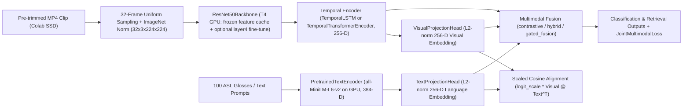

# Implementation Plan: Multimodal ASL Recognition on `Voxel51/WLASL` (`WLASL-100`, Option A)

> **Scope & Dataset Decision:** All video clips come **strictly from `Voxel51/WLASL` (Option A: Top-100 most-populated classes, 1,120 pre-trimmed clips, 10–16 clips/class)**. Official `WLASL_v0.3.json` is used **only as a metadata lookup** to restore `signer_id` so train/val/test splits have **zero signer leakage**. All training and feature extraction execute on **Google Colab GPU (T4)**, while original Drive caches (`processed/resnet50_features/`) and legacy CSVs remain untouched.

---

## 1. Storage Architecture & Data Boundaries

Because Colab VM disk (`/content/`) resets whenever a session disconnects, while Google Drive FUSE (`/content/drive/`) is persistent but slow for thousands of small video opens, the project separates storage into three clear tiers:

### 1.1 Tier 1 — Persistent Google Drive (`~750 MB – 1.2 GB` total)
Root directory: **`/content/drive/MyDrive/ASL-Recognition/voxel51_wlasl100/`** (completely isolated from legacy `/content/drive/MyDrive/ASL-Recognition/processed/` and `videos/`):

```text
/content/drive/MyDrive/ASL-Recognition/voxel51_wlasl100/
├── metadata/
│   ├── samples_top100.json                # Filtered Voxel51 samples metadata (1,120 rows)
│   ├── wlasl_v03_lookup.json              # Raw signer_id & official split reference
│   ├── voxel51_wlasl100_master.csv        # Unified table: video_id, gloss, signer_id, filepath, bbox, fps, frames
│   ├── train.csv / val.csv / test.csv     # Signer-disjoint split CSVs (~70% / ~15% / ~15%)
│   ├── class_to_id.json / id_to_class.json # Bijective 0..99 class map (0 zero-train classes)
│   ├── signer_split_audit.json            # Zero-overlap & class-support verification log
│   └── video_readability_audit.csv        # 100% OpenCV decode check across all 1,120 clips
├── videos/
│   ├── voxel51_wlasl100_videos.tar        # Single archive of the 1,120 MP4s (~500 MB) for fast Colab staging
│   └── raw_mp4/<video_id>.mp4             # Optional uncompressed Drive mirror (~500 MB)
├── features/
│   ├── X_train.npy / y_train.npy / done_train.npy / manifest_train.csv
│   ├── X_val.npy   / y_val.npy   / done_val.npy   / manifest_val.csv
│   ├── X_test.npy  / y_test.npy  / done_test.npy  / manifest_test.csv
│   ├── text_embeddings_gloss.pt           # all-MiniLM-L6-v2 (100, 384) raw gloss embeddings (<1 MB)
│   ├── text_embeddings_prompt.pt          # all-MiniLM-L6-v2 (100, 384) prompted text embeddings (<1 MB)
│   ├── gloss_texts.json                   # Exact prompts used per class_id
│   └── feature_extraction_summary.json    # Shape, finite, manifest & alignment checks
├── checkpoints/
│   ├── visual_lstm/best_model.pt          # Best checkpoint + training_history.csv + config.yaml
│   ├── visual_transformer/best_model.pt
│   ├── multimodal_contrastive/best_model.pt
│   ├── multimodal_hybrid/best_model.pt
│   ├── multimodal_gated_fusion/best_model.pt
│   └── multimodal_finetuned/best_model.pt
├── experiments/
│   ├── results_summary.csv                # Unified metrics comparison table across all models
│   ├── test_evaluation_report.json        # Locked test-set classification + retrieval report
│   └── ablation_results.csv               # Prompt, fusion-mode & fine-tuning ablations
└── reports/
    ├── visual_examples/                   # Sample frame grids verifying decoded clips & bboxes
    ├── plots/                             # Training curves, confusion matrices, t-SNE/UMAP plots
    └── logs/                              # Notebook execution logs
```

### 1.2 Tier 2 — Colab Local NVMe Scratch (`/content/wlasl100_cache/`, Ephemeral)
Used during Colab GPU sessions for maximum I/O throughput:
- At notebook start, unpack `voxel51_wlasl100_videos.tar` (`~500 MB`) from Drive → `/content/wlasl100_cache/videos/` in **~3–5 seconds** (eliminating Google Drive FUSE file-open stalls during OpenCV decoding and end-to-end `ResNet50` fine-tuning).
- Copy cached `.npy` / `.pt` files to `/content/wlasl100_cache/features/` for zero-latency GPU `DataLoader` reads.
- **Checkpoint durability rule:** Every model checkpoint, CSV log, and metric report writes **directly back to Google Drive (`checkpoints/`, `experiments/`)** at each best epoch so a Colab timeout never loses progress.

### 1.3 Tier 3 — Local Workspace & Git Repository (`ASL-Generator-recognition-system/`)
Tracked in Git (lightweight code & small metadata only; **zero large binaries**):
- Python modules in [`src/`](../src/), CLI [`scripts/`](../scripts/), [`backend/`](../backend/), unit [`tests/`](../tests/), Colab [`notebooks/`](../notebooks/), and YAML [`configs/`](../configs/).
- Lightweight metadata snapshot (`metadata/voxel51_wlasl100/{train,val,test}.csv`, `class_to_id.json`, `id_to_class.json`, total `< 250 KB`) may optionally be synced into Git after Notebook `01b` finishes so local unit tests and configs align cleanly.
- Raw `.mp4`/`.tar` archives, `.npy` feature caches, and `.pt` checkpoints stay **on Google Drive** (gitignored locally; download only the single finalized winning `.pt` + `vocab_embeddings.pt` when running the local FastAPI backend/demo).

---

## 2. Dataset Switch Strategy (`Drive 6,446` → `Voxel51/WLASL` Top-100)

### 2.1 Verified Dataset Facts
| Property | Previous Drive Dataset | Target `Voxel51/WLASL` Option A |
|---|---:|---:|
| **Classes** | 1,800 (3 with 0 train videos) | **100** (Top-100 by clip count) |
| **Total Clips** | 6,446 (`~30.6%` of WLASL) | **1,120** (`~9.3%` of Voxel51's 11,980 clips) |
| **Clips / Class** | Median 2.0 in train (`80% <= 3`) | **10–16 total** (`min=10, median=11.0, mean=11.20`) |
| **Clip Length** | Included 131 multi-min segmented videos | **Pre-trimmed short clips** (`15–233` frames, `0.57s–8.12s`) |
| **Signer ID Source** | `wlasl_final_optimized_signer_split.csv` | 606 already in local CSV + 514 looked up from `WLASL_v0.3.json` |

### 2.2 Switch & Signer-Disjoint Split Procedure
1. **Selective Hugging Face Fetch (`~500 MB` instead of `5.5 GB`):** Filter `samples.json` to the Top-100 glosses (`1,120` filepaths) and fetch only those `.mp4` files with `huggingface_hub.snapshot_download(..., allow_patterns=...)`.
2. **Metadata & `signer_id` Recovery:** Join `video_id` (`00335.mp4` → `335`) with `WLASL_v0.3.json` to recover `signer_id` and source info; verify `0` gloss disagreements and flag any missing `signer_id` rows explicitly before splitting.
3. **Balanced Signer-Disjoint Splitting (`~70% Train / ~15% Val / ~15% Test`):** Assign whole **`signer_id` groups** across splits using class-balanced greedy optimization so:
   - `train_signers ∩ val_signers = ∅`, `train_signers ∩ test_signers = ∅`, `val_signers ∩ test_signers = ∅`
   - **All 100 classes** appear in Train (`>= 6` preferred), Val (`>= 1`, target `>= 2`), and Test (`>= 1`, target `>= 2`).
   - Enforced programmatically via [`validate_splits`](../src/data/split.py).
4. **100% Decode Verification:** Decode every clip with OpenCV (`total_frames >= 15`, non-zero size, finite `(32, 3, 224, 224)` tensor), pack into `voxel51_wlasl100_videos.tar` on Drive, and save sample frame grids to `reports/visual_examples/`.

---

## 3. Colab GPU Training & Pipeline Design

All heavy preprocessing, feature extraction, and training run on **Google Colab T4 GPU (`15 GB` VRAM)** using `torch.amp.autocast("cuda")` mixed precision (`GradScaler`), pinned `DataLoader`s, deterministic seeds (`42`), and synced repo code (`!git clone / git pull` or Drive-mounted `src/`).



### 3.1 Multimodal Branch Details
- **Visual Branch:** Uniform 32-frame sampling (`frame_start=1, frame_end=-1` pre-trimmed clips) → frozen `ResNet50Backbone` (`(32, 2048)` `float16` features = `~147 MB` total across all 1,120 clips, fitting entirely in GPU/RAM!) → `TemporalLSTM` vs. `TemporalTransformerEncoder` → `VisualProjectionHead` (`L2`-normalized `256-D`). Because Option A has only `1,120` clips on local Colab SSD, **Phase 2 GPU end-to-end fine-tuning** (`unfreeze_last_blocks=1` on `layer4` with frozen `BatchNorm2d`) runs comfortably on a single T4 GPU (`batch_size=8`, AMP).
- **Language Branch ([`language_encoder.py`](../src/models/language/language_encoder.py)):** Encodes the 100 glosses via `sentence-transformers/all-MiniLM-L6-v2` (`384-D`) → `TextProjectionHead` (`L2`-normalized `256-D`), ablating raw gloss (`"{gloss}"`) vs. descriptive prompt (`"An American Sign Language sign representing the word '{gloss}'"`).
- **Multimodal Alignment & Fusion ([`multimodal_model.py`](../src/models/multimodal/multimodal_model.py) + [`losses.py`](../src/training/losses.py)):** Benchmarks `contrastive`, `hybrid`, and `gated_fusion` under cross-entropy (`label_smoothing=0.05`) + vocabulary contrastive loss + multi-positive batch InfoNCE.

---

## 4. Validation, Training & Testing Protocol

### 4.1 Strict Split Rules & Augmentations
- **Train (`~70%`):** Only split used for gradient updates, inverse-frequency weights / `WeightedRandomSampler`, and training augmentations ([`augmentation.py`](../src/preprocessing/augmentation.py): temporal crop `0.85–1.0`, monotonic jitter, feature dropout `0.10`, Gaussian noise `0.02`, mild spatial crops during raw-video fine-tuning). **Horizontal flips stay disabled (`allow_horizontal_flip=False`).**
- **Validation (`~15%`, unseen signers):** Used exclusively for LR scheduling, early stopping, saving `best_model.pt` to Drive, and choosing between `LSTM`/`Transformer`, fusion modes, and prompts.
- **Test (`~15%`, unseen signers):** **Locked until all training & ablations finish.** Evaluated once per finalized model on identical splits for honest 1:1 comparisons inside the project.

### 4.2 Experiment & Evaluation Matrix (`experiments/results_summary.csv`)
| Stage | Model / Ablation | GPU Runtime | Core Metrics Logged |
|---|---|---|---|
| **0** | Random (`1.0%` Top-1) & Majority Baselines | Instant | Top-1, Top-5 |
| **1** | `VisualClassifier` (`LSTM`, cached `float16`) | ~1–2 min | Top-1, Top-5, Macro-F1, `unique_predicted_classes` |
| **2** | `VisualClassifier` (`Transformer` + Aug + Smoothing) | ~1–2 min | Top-1, Top-5, Macro-F1, per-class F1 |
| **3** | `MultimodalASLModel` (`contrastive`) | ~2 min | + `Video→Text` / `Text→Video` `R@1, R@5, R@10, MRR` |
| **4** | `MultimodalASLModel` (`hybrid` & `gated_fusion`) | ~2–3 min | Classification + Retrieval + Fusion Gate weights |
| **5** | Prompt Template & `ResNet50(layer4)` End-to-End Fine-Tune | ~15–25 min | Quantify semantic prompt & spatial backbone gains |
| **6** | Optional Zero-Shot / Unseen-Gloss Retrieval Check | ~3 min | Held-out gloss `Recall@K` (optional secondary ablation) |

---

## 5. Step-by-Step Colab & Repo Execution Sequence

1. **Repo Step (Local):** Add `src/data/voxel51_adapter.py`, Option A configs (`configs/wlasl100_visual.yaml`, `configs/wlasl100_multimodal.yaml`), unit tests, and **Notebook `01b_voxel51_wlasl100_setup.ipynb`**.
2. **Colab Run 1 (`01b_voxel51_wlasl100_setup.ipynb`):** Selectively fetch the `1,120` clips + `WLASL_v0.3.json`, build/verify signer-disjoint `train/val/test.csv`, validate all 1,120 videos with OpenCV, pack `voxel51_wlasl100_videos.tar` + metadata to Google Drive `voxel51_wlasl100/`.
3. **Colab GPU Run 2 (`03b_voxel51_wlasl100_feature_extraction.ipynb`, T4 GPU):** Unpack `.tar` to `/content/wlasl100_cache/`, extract `(N, 32, 2048)` `float16` visual caches + `all-MiniLM-L6-v2` `(100, 384)` text caches (`gloss` & `prompt`), verify `0` NaN/zero/manifest errors, persist to Drive `features/`.
4. **Colab GPU Run 3 (`04b_voxel51_visual_baseline_training.ipynb`, T4 GPU):** Train & validate Visual Baselines (Majority/Random, LSTM, Transformer), persist best checkpoints & curves to Drive.
5. **Colab GPU Run 4 (`05c_voxel51_multimodal_training.ipynb`, T4 GPU):** Train & ablate Multimodal models (`contrastive`, `hybrid`, `gated_fusion`, prompts, `layer4` fine-tune) strictly on `val`.
6. **Colab GPU Run 5 (`06b_voxel51_final_evaluation.ipynb`, T4 GPU):** Run single locked evaluation on unseen `test` split across all finalized models, generate confusion/t-SNE/comparison plots in Drive `reports/`, export best multimodal checkpoint + vocabulary `.pt`.
7. **Repo Step (Local Backend/Demo & Docs):** Connect best Drive checkpoint to [`backend/app/main.py`](../backend/app/main.py), run FastAPI + full `pytest` verification, update `README.md` and `reports/` with observed numbers only.

